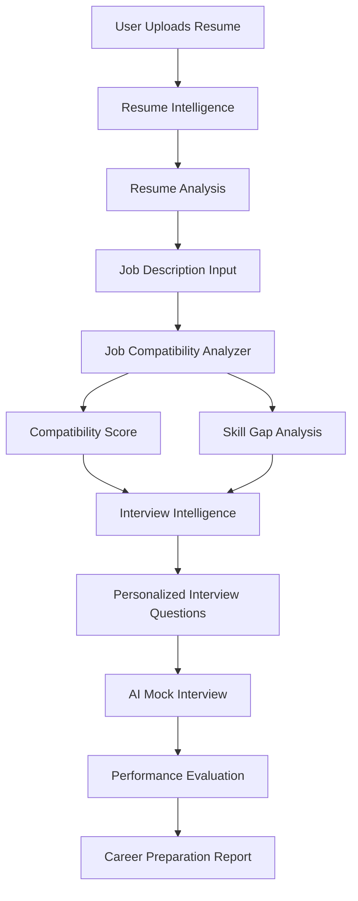

# 🚀 JobFit AI — Your Personal AI Career Assistant

> **An AI-powered career intelligence platform designed to help job seekers analyze their resumes, understand job compatibility, and prepare confidently for interviews.**

**JobFit AI** is an evolving AI engineering project that aims to simplify the job preparation journey through intelligent resume analysis, job compatibility assessment, and personalized interview preparation.

The project begins with an existing AI-powered recruitment automation engine that extracts, validates, and structures candidate information from resumes. This engineering foundation is now evolving into a consumer-focused career preparation platform.

---

## 🎯 Vision

Finding the right job isn't just about having a good resume. It's about understanding your strengths, identifying skill gaps, finding suitable opportunities, and preparing effectively for interviews.

JobFit AI aims to bring these capabilities together in one platform.

**Our goal:**

> Know where you stand. Know what you're missing. Know how to prepare.

---

## ⚙️ Current Foundation — Autonomous Hiring Engine

JobFit AI builds upon an existing AI-powered recruitment automation system.

The initial implementation demonstrates an automated ETL pipeline that monitors Gmail for job applications, processes PDF resumes, validates documents, and extracts structured candidate information.

### Existing Capabilities

* **Automated Email Monitoring:** Monitors Gmail for incoming job applications.
* **Resume Processing:** Downloads and extracts text from PDF resumes.
* **Intelligent Document Validation:** Uses an AI classifier to distinguish resumes from unrelated documents.
* **AI-Powered Information Extraction:** Extracts candidate names, contact information, skills, and experience.
* **Structured Data Validation:** Uses Pydantic to validate extracted candidate information.
* **Candidate Summarization:** Generates concise summaries of candidate profiles.
* **Interview Question Generation:** Generates personalized interview questions based on candidate information.
* **Google Sheets Integration:** Stores structured candidate information in Google Sheets.
* **Error Handling:** Includes retry mechanisms and application logging.

This existing implementation serves as the engineering foundation for the broader JobFit AI vision.

---

## 🧠 Future Product — JobFit AI

The project is evolving from recruiter-focused automation into a D2C career preparation platform.

The planned product will focus on three interconnected capabilities.

### 1. 📄 Resume Intelligence

Help individuals understand and improve their resumes.

**Planned Capabilities:**

* PDF and DOCX resume uploads.
* AI-powered resume analysis.
* ATS compatibility assessment.
* Resume quality evaluation.
* Identification of weak descriptions and missing information.
* Skill identification and analysis.
* Actionable resume improvement suggestions.
* Personalized resume analysis reports.

### 2. 🎯 Job Compatibility Analyzer

Help job seekers understand how well their profiles match specific job opportunities.

**Planned Capabilities:**

* Job description analysis.
* Resume-to-job matching.
* Job compatibility scoring.
* Matching and missing skill identification.
* Experience requirement comparison.
* Job suitability assessment.
* Personalized skill-gap recommendations.
* Suggestions to improve job compatibility.

### 3. 🎤 Interview Intelligence

Help individuals prepare for interviews using their resumes and target job descriptions.

**Planned Capabilities:**

* AI-generated interview questions.
* Personalized technical interview preparation.
* HR interview preparation.
* Resume-based interview questions.
* Job-specific interview preparation.
* AI-powered mock interviews.
* Answer evaluation and feedback.
* Interview performance reports.
* Identification of technical and communication weaknesses.

---

## 🔄 Product Workflow

The planned JobFit AI experience will connect all three capabilities into one career preparation journey.

---

## 🛠️ Technology Stack

### Core

* Python 3.10+

### AI & LLM

* GPT OSS 20b (via Groq API)
* LangChain

### Backend & Validation

* Python
* Pydantic

### Integrations

* Gmail API
* Google Sheets API

### Document Processing

* PyPDF2

### Planned Engineering Direction

* Resume parsing and document intelligence.
* AI-powered job matching.
* Structured evaluation pipelines.
* Interactive interview workflows.
* Consumer-facing application interface.

---

## 📊 Development Status

JobFit AI is currently transitioning from its original recruitment automation implementation into a consumer-focused AI career preparation platform.

| Component                        | Status        |
| -------------------------------- | ------------- |
| Gmail Integration                | ✅ Implemented |
| Automated Resume Detection       | ✅ Implemented |
| PDF Text Extraction              | ✅ Implemented |
| AI Resume Validation             | ✅ Implemented |
| Structured Candidate Extraction  | ✅ Implemented |
| Candidate Profile Summarization  | ✅ Implemented |
| Interview Question Generation    | ✅ Implemented |
| Google Sheets Integration        | ✅ Implemented |
| Resume Intelligence              | 🔄 Planned    |
| ATS Compatibility Analysis       | 🔄 Planned    |
| Job Compatibility Analyzer       | 🔄 Planned    |
| Skill Gap Analysis               | 🔄 Planned    |
| AI Mock Interviews               | 🔄 Planned    |
| Interview Performance Evaluation | 🔄 Planned    |
| Consumer Application Interface   | 🔄 Planned    |

---

## 🔮 Future Direction

The long-term vision is to transform JobFit AI into a unified career preparation assistant.

Instead of offering disconnected resume-building and interview-preparation utilities, JobFit AI aims to connect resume intelligence, job compatibility, and interview preparation into a single experience.

The existing recruitment automation engine provides the initial engineering foundation. The next stage focuses on building the consumer-facing capabilities around it.

---

## 👨‍💻 Project Information

**Project:** JobFit AI
**Category:** AI Engineering / CareerTech / Generative AI
**Product Direction:** Direct-to-Consumer (D2C)
**Development Status:** In Development
**Portfolio:** Third AI Engineering Project

---

**Built by Dhananjay Mishra**

*Building intelligent AI systems that solve practical problems.*
